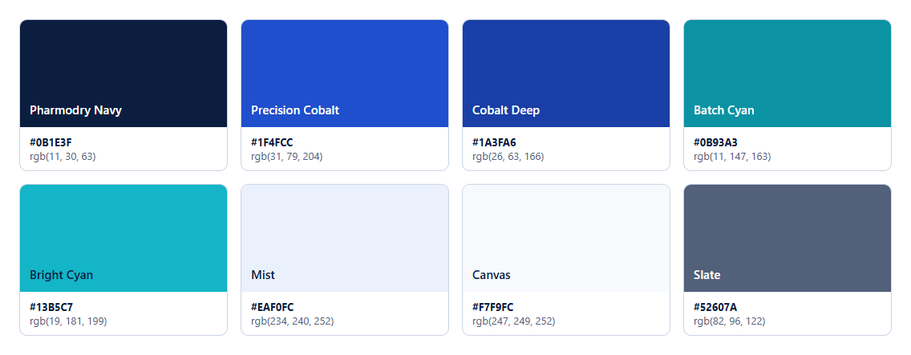

# Pharmodry — Brand Guidelines

**Name:** Pharmodry
**Brand line:** *Precision in Every Batch.*
**Category:** pharmaceutical operations, quality and compliance software for manufacturers.

## 1. Logo

The mark is a **"P" whose bowl is a two-tone capsule** (white and cyan halves with a visible seam), plus a **precision dot**. It stands for:

- the pharmaceutical dosage form
- the two halves of manufacturing and quality coming together
- the exact point of control behind every released batch

The mark sits in a rounded square badge so it works as an app icon and favicon.

| File | Use |
|---|---|
| `logo/pharmodry-logo.svg` / `pharmodry-logo-1320.png` | Horizontal lockup (mark + wordmark + brand line) on white or light backgrounds |
| `logo/pharmodry-logo-dark.svg` / `pharmodry-logo-dark-1320.png` | Lockup on Navy or dark backgrounds (cobalt badge, white wordmark) |
| `logo/pharmodry-mark.svg` / `-512.png` / `-192.png` / `-32.png` | Mark alone: favicon, app icon, avatars (navy badge) |
| `logo/pharmodry-mark-dark.svg` / `-dark-512.png` | Mark on dark backgrounds (cobalt badge) |
| `logo/apple-touch-icon.png` | 180 × 180 home-screen icon |
| `logo/pharmodry-mark-mono.svg` | One-colour (print, embossing, fax) |
| `logo/pharmodry-mark-reverse.svg` | One-colour reversed (white badge, navy mark) for dark single-colour use |
| `logo/colors.json` | Machine-readable palette |

**Clear space:** at least the height of the precision dot × 2 on every side.
**Minimum size:**
- the mark is legible from 16 px (verified at 32 px)
- the horizontal lockup is legible from 140 px wide; below that, use the mark alone

**Don'ts:**
- don't recolour the capsule halves
- don't place the navy badge on navy or near-black (use the dark variant)
- don't stretch, rotate, outline or add shadows
- don't separate the dot from the "P"

The wordmark in the SVG masters is live text in *Inter → Segoe UI → Helvetica Neue → Arial*. For print production, use the PNG renders or outline the text in a vector editor.

## 2. Colour palette

| Name | HEX | RGB | Role |
|---|---|---|---|
| **Pharmodry Navy** | `#0B1E3F` | 11, 30, 63 | Brand ink: wordmark, headings, login panel, logo badge |
| **Precision Cobalt** | `#1F4FCC` | 31, 79, 204 | Primary actions, links, focus ring, active navigation; logo badge on dark |
| **Cobalt Deep** | `#1A3FA6` | 26, 63, 166 | Text on Mist, hover/pressed states |
| **Batch Cyan** | `#0B93A3` | 11, 147, 163 | Accent graphics on light backgrounds (≥ 3:1) |
| **Bright Cyan** | `#13B5C7` | 19, 181, 199 | Capsule half and precision dot; accents on Navy (6.7:1) |
| **Mist** | `#EAF0FC` | 234, 240, 252 | Selected/active backgrounds, table headers |
| **Canvas** | `#F7F9FC` | 247, 249, 252 | App background |
| **Slate** | `#52607A` | 82, 96, 122 | Secondary text, brand line |

**Status colours are functional, not brand colours,** and are unchanged so that their meaning never changes: success green, warning amber, danger red, info blue, progress violet. The chart palette (`--series-*`) is the separately validated colour-blind-safe data palette.

**Dark mode:**
- Cobalt is lifted to `#80A3F4` (primary), with near-navy text on it.
- Surfaces are deep navy: background `hsl(219 50% 7%)`, cards `hsl(218 45% 10%)`.
- The logo uses the cobalt badge.

### Implementation

- **CSS tokens:** `apps/web/app/globals.css` (`--primary`, `--accent`, `--ring`, `--sidebar-*`, plus `--brand-navy`, `--brand-cobalt`, `--brand-cyan`, `--brand-cyan-bright`).
- **Tailwind:** `brand.navy`, `brand.cobalt`, `brand.cobalt-deep`, `brand.cyan`, `brand.cyan-bright`, `brand.mist`, `brand.slate` in `apps/web/tailwind.config.ts`.
- **React logo:** `apps/web/components/shell/logo.tsx` (`Logo`, `LogoMark`; the badge switches to cobalt in dark mode).
- **PDF manuals:** `docs/USER_MANUALS/SOURCES/build-manuals.mjs` (the same palette, inline logo).

## 3. Accessibility (measured, WCAG 2.2)

| Pair | Light | Dark |
|---|---|---|
| Button text on primary | 7.0 : 1 | 7.7 : 1 |
| Body text on background | 15.4 : 1 | 16.6 : 1 |
| Muted text on background | 6.0 : 1 | 7.5 : 1 |
| Accent text on accent background | 7.8 : 1 | 7.9 : 1 |
| Sidebar text on active item | 11.1 : 1 | 11.3 : 1 |
| Primary (links) on background | 6.7 : 1 | 7.7 : 1 |
| Batch Cyan graphics on white | 3.7 : 1 (non-text ≥ 3:1) | — |

All text pairs meet AA (4.5:1), and most meet AAA (7:1). Never use Bright Cyan for text on white (2.5:1).

## 4. Typography

| Use | Typeface | Weight / size |
|---|---|---|
| UI and documents | **Inter** (fallbacks: Segoe UI, system-ui, Helvetica Neue, Arial) | 400 body, 500 labels, 600 headings, 700 wordmark |
| Data, IDs, batch numbers | **Cascadia Code** (fallbacks: JetBrains Mono, Consolas) | 400–600 |
| Wordmark | Inter Bold, tracking −0.6 at 36 px | — |
| Brand line | Inter Medium, sentence case, ending with a full stop | — |

Fonts are resolved from the operating system (no web-font download), which keeps the application usable offline and inside restricted plant networks.

## 5. Visual style

- **Calm, clinical, precise:** generous white space, 0.6 rem corner radius, 1 px borders and no decorative gradients in working screens. The only gradient is the Navy → Cobalt → Cyan band on covers and the login panel glow.
- **Colour carries meaning:**
  - Cobalt means "you can act"
  - status colours mean state
  - Navy means brand and structure
- **Voice:**
  - concise, factual, regulatory-literate
  - never claims compliance or validation the software cannot establish

## 6. Naming

- Always write **Pharmodry** (capital P, one word). Never "PharmoDry" or "PHARMODRY" except in all-caps typographic contexts.
- The brand line is written exactly *Precision in Every Batch.*, with a capital E and B and a closing full stop.
- Code identifiers:
  - npm scope `@pharmodry/*`
  - refresh cookie `pmd_rt`
  - anti-CSRF header value `pharmodry`
  - test databases `pmd_e2e_*` / `pmd_ui_*`
