# Pharmodry — Production Operator User Manual

- Product: Pharmodry 0.1.0 (MVP release)
- Intended audience: Operators executing manufacturing steps.
- Document version: 1.0
- Generated: 2026-10-25 (screenshots captured 2026-10-25)
- Role code: PRODUCTION_OPERATOR

> Screenshots show fictional demonstration data. Pharmodry is not a validated system; use within your approved SOPs.

## Contents

1. Purpose and scope
2. Role responsibilities
3. Signing in and signing out
4. Home page and dashboard overview
5. Navigation and module overview
6. Features and step-by-step instructions
7. Field-by-field explanations, required inputs and validation rules
8. Buttons and their functions
9. Workflow, approvals and electronic signatures
10. Status meanings
11. Search, filters, sorting and pagination
12. Reports and exports
13. Notifications and alerts
14. Error messages and troubleshooting
15. Common mistakes and how to prevent them
16. Security and access limitations
17. Practical end-to-end example
18. Frequently asked questions
19. Glossary
20. Escalation

## 1. Purpose and scope

Executes eBMR steps — starts each step with qualified, calibrated equipment, records parameters and in-process checks, and signs. Can view batches and master data and raise deviations. Cannot verify steps, create batches or release anything.

This manual covers every Pharmodry screen available to the Production Operator role in release 0.1.0. Your exact access is set by your company’s administrator; if your account has additional roles or a site restriction, you may see more or fewer options than described. Configuration-dependent behaviour (for example tolerances, aging thresholds, calibration policy, AI availability) is marked as such.

> **Not available in this release:** Pharmacovigilance, sales/distribution and accounting modules; customer-level distribution in recalls; e-mail notifications; serial-number management; MFA/single sign-on. These are not described as working anywhere in this manual.

## 2. Role responsibilities

- Follow the step order and master instructions.
- Record readings at the time they are taken (contemporaneously).
- Sign each step with your own password.
- Raise a deviation immediately for any problem.

### Dependencies on other departments

- Production Supervisor — starts batches and verifies steps.
- Engineering — equipment availability and calibration.

## 3. Signing in and signing out

1. Open the Pharmodry address provided by your administrator in a current browser (Microsoft Edge, Chrome or Firefox).
2. Enter your company e-mail address and password and select Sign in.
3. After five consecutive wrong passwords the account is locked for 15 minutes; an administrator can unlock it.
4. To sign out, open the user menu at the top right and choose Sign out. Always sign out on shared computers.
5. Change your password under Profile & security → Change password (at least 10 characters with upper-case, lower-case and a digit). Your password is also your electronic-signature credential — never share it.
6. Profile → Active sessions lists devices signed in to your account; revoke any session you do not recognise.

*Figure 1 — Sign-in page. Sign-in page. Enter your company e-mail and password, then select Sign in.*

1. Company e-mail address
2. Password (also your e-signature credential)
3. Sign in

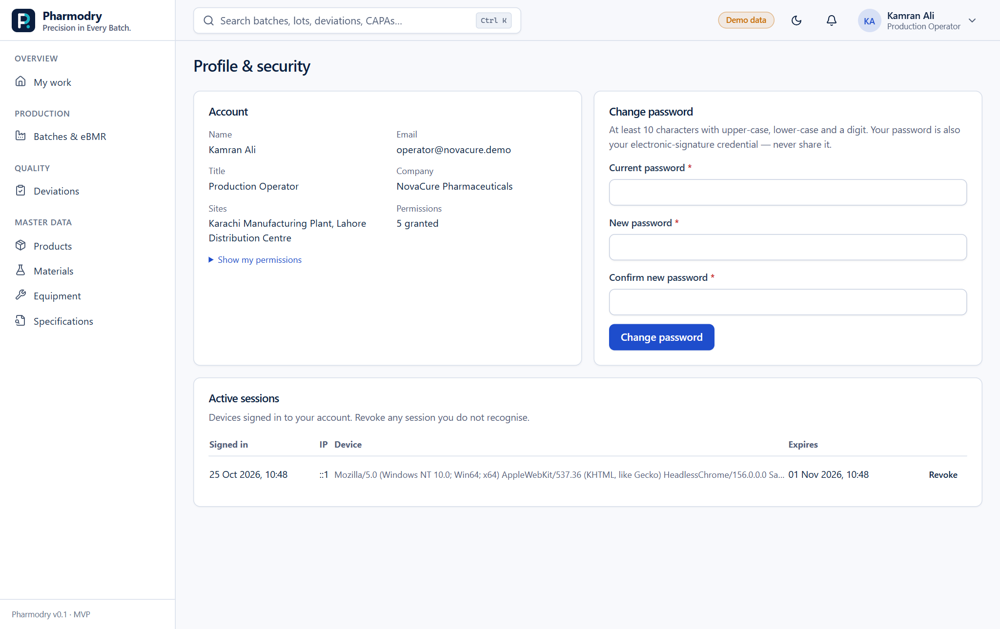

*Figure 2 — Profile & security. Profile: password change and active sessions.*

## 4. Home page and dashboard overview

After sign-in you land on My work. It greets you by name and lists the work queues that match your permissions — for example batches awaiting QA release, material lots awaiting disposition, open QC samples, deviations or CAPAs you own, batches on the shop floor, planned batches to prepare and purchase orders awaiting receipt. Each queue links straight to the records. Queues you have no permission for are not shown.

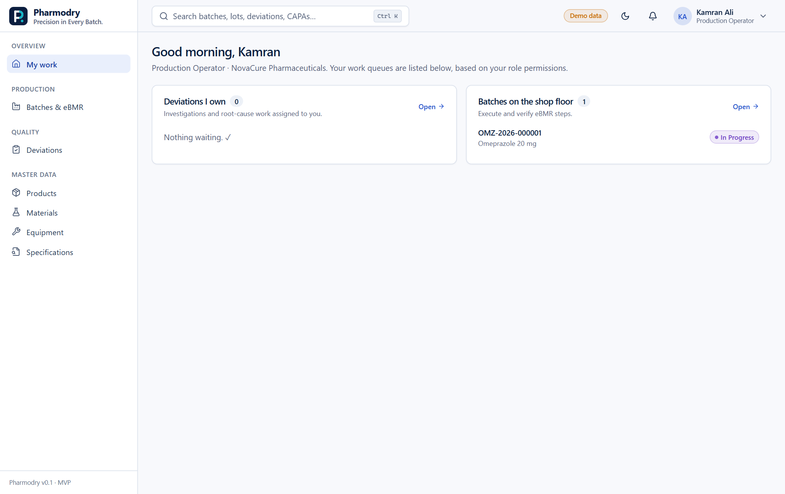

*Figure 3 — My work (home). Home page with the work queues available to this role.*

Your role has no dashboard or Command Center access; My work is your starting point.

## 5. Navigation and module overview

- The left sidebar lists only the modules your role can open, grouped into Overview, Supply & inventory, Production, Quality, Master data and Governance.
- The top bar has global search (“Search batches, lots, deviations, CAPAs…”, shortcut Ctrl K), a “Demo data” badge in demonstration environments, the light/dark theme toggle, the notification bell and your user menu (name and job title).
- Record numbers are links; detail pages show a status badge, key facts, actions you may perform and tabs with history.

The sidebar below was recorded from the application while signed in as the demo Production Operator (operator@novacure.demo).

| Sidebar group | Menu entry | Address |
|---|---|---|
| Overview | My work | / |
| Production | Batches & eBMR | /production/batches |
| Quality | Deviations | /quality/deviations |
| Master data | Products | /master-data/products |
| Master data | Materials | /master-data/materials |
| Master data | Equipment | /master-data/equipment |
| Master data | Specifications | /master-data/specifications |

## 6. Features and step-by-step instructions

Each section explains a module you can open, the procedures you are allowed to perform (numbered steps) and screenshots of the real screens. Procedures that need permissions your role does not hold are listed under “Not available to your role”.

### Batches and electronic batch records (eBMR)

Batch lifecycle: Planned → Material reserved → Ready → In progress → Awaiting QC → Awaiting QA → Released / Rejected → Closed (or Cancelled before start). The batch page has tabs Overview, Manufacturing (eBMR), Materials, QC, Deviations, Approvals and Audit trail, and shows GS1 data (GTIN, expiry, batch) for the 2D DataMatrix when the product has a GTIN.

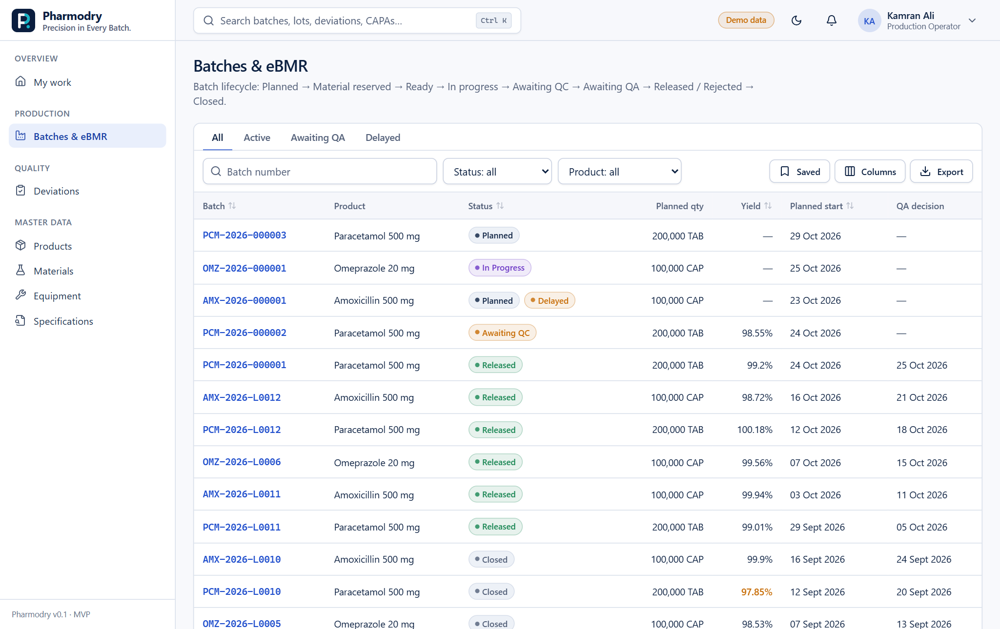

*Figure 4 — Batches & eBMR. Batch list with lifecycle status, yield and QA decision.*

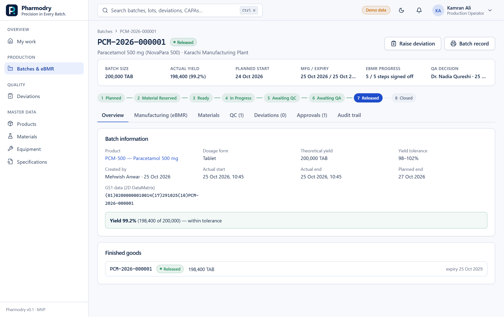

*Figure 5 — Released batch — overview. Overview of a released batch: yield, finished goods, GS1 data and QA decision.*

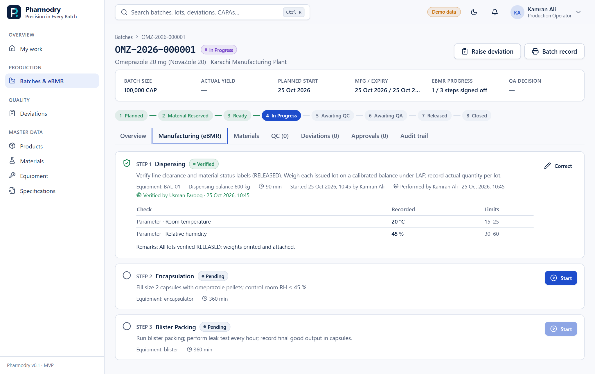

*Figure 6 — Batch in progress — eBMR. Electronic batch record of a batch in progress: steps, parameters, signatures.*

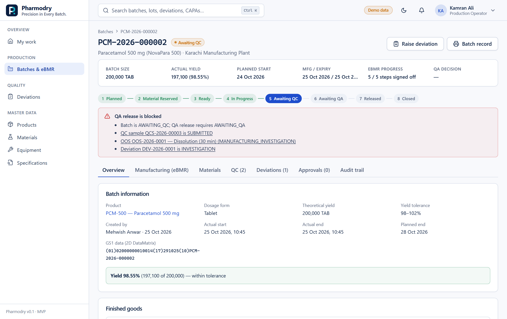

*Figure 7 — Batch blocked by OOS. A batch whose release is blocked: failed QC and an open OOS investigation.*

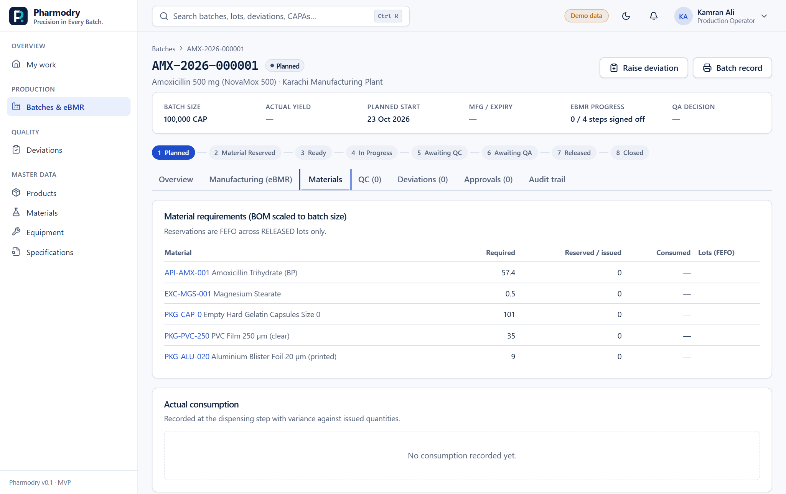

*Figure 8 — Batch with material shortage. A planned batch that cannot reserve materials because released stock is insufficient.*

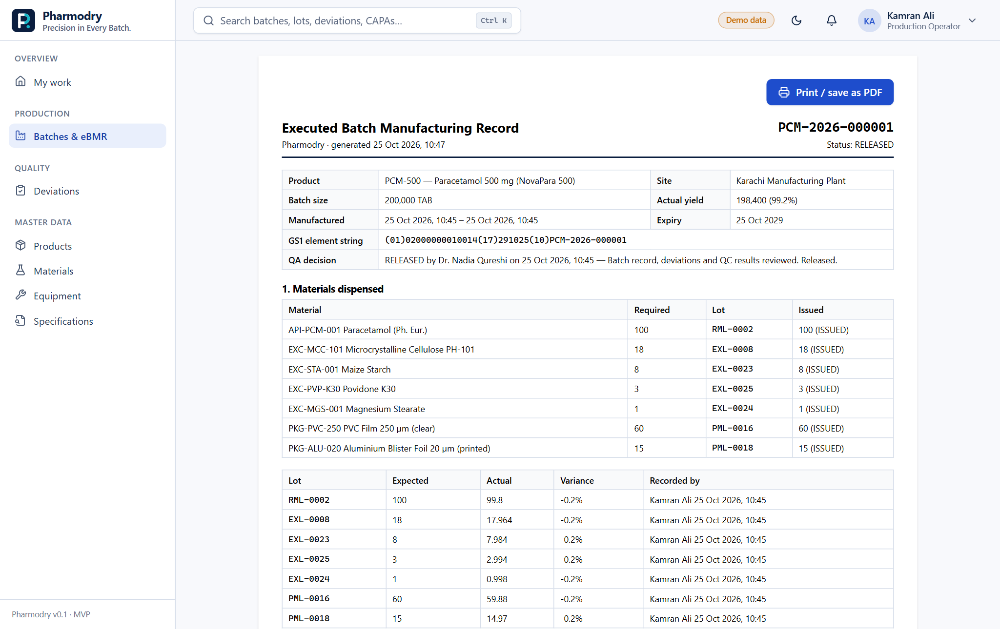

*Figure 9 — Printable batch record. Print-ready batch manufacturing record (use the browser’s Save as PDF).*

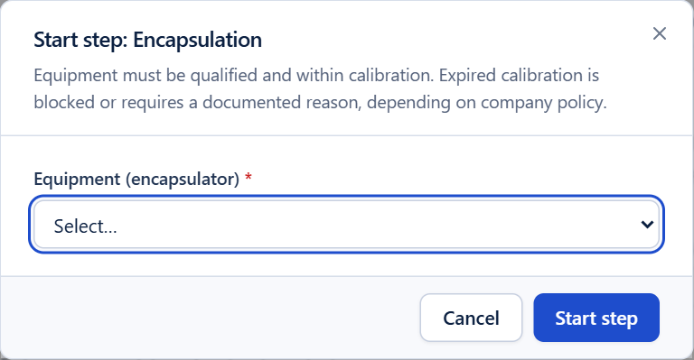

*Figure 10 — Start an eBMR step. Starting a step: select qualified, calibrated equipment.*

#### Execute an eBMR step

1. Open the batch and the Manufacturing (eBMR) tab. Steps must be done in order.
2. Select Start on the next step (enabled only when the previous step is done) and choose the equipment. Equipment must be qualified and within calibration; expired calibration is blocked (or, under WARN policy, needs an Override reason).
3. Perform the operation per the master instructions.
4. Select Record & sign, enter every process parameter and in-process control reading. Out-of-limit readings are flagged (“Out-of-limit reading”).
5. Enter Remarks if needed, re-enter your password and sign.

*Figure 11 — Complete and sign step DISP. Recording parameters and in-process checks, then signing the step.*

*Figure 12 — Complete and sign step COMP. Recording parameters and in-process checks, then signing the step.*

*Figure 13 — All steps completed. All eBMR steps completed and signed; awaiting supervisor verification.*

#### Record a correction

1. On a completed step select Correct.
2. Choose the Field, enter the New value and the Reason for correction.
3. Select Record correction. The original value, new value, reason and your identity are kept; a verified step returns to COMPLETED and must be re-verified.

#### Print the batch manufacturing record

1. Open the batch and select Batch record (opens in a new tab).
2. Use Print / the browser’s Save as PDF.

#### Raise a deviation from a batch

1. On the batch page select Raise deviation; the batch is pre-filled.

> **Not available to your role:** Create a batch — requires batch.create; Reserve materials (FEFO) — requires batch.reserve; Issue materials to production — requires inventory.issue; Start the batch — requires batch.start; Verify eBMR steps — requires batch.verify; Complete manufacturing — requires batch.complete; QA release or rejection of a batch — requires batch.approve.

### Deviations

Draft → Submitted → QA review → Investigation → Root cause → CAPA → Effectiveness check → QA closure. Aging: 0–15 days normal, 16–30 attention, more than 30 overdue (configurable). Root-cause analysis uses structured 5-Whys and a fishbone (6M) category; each save is versioned and QA approves the final root cause.

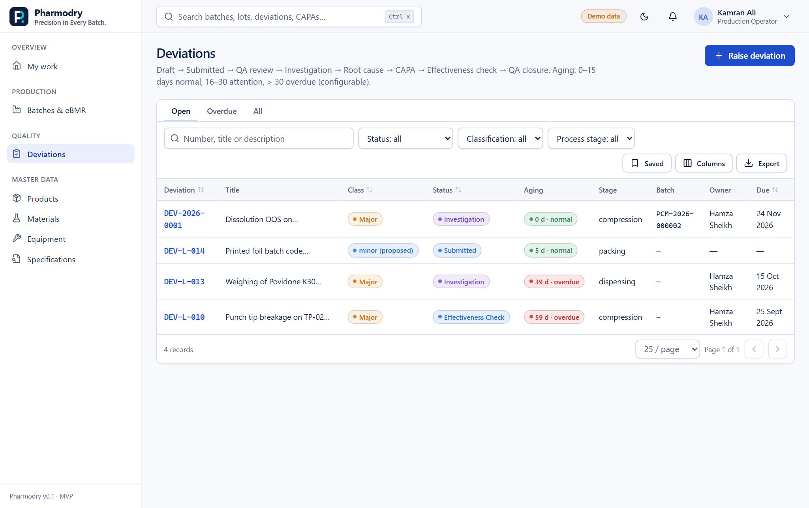

*Figure 14 — Deviations. Deviation register with classification, aging and owner.*

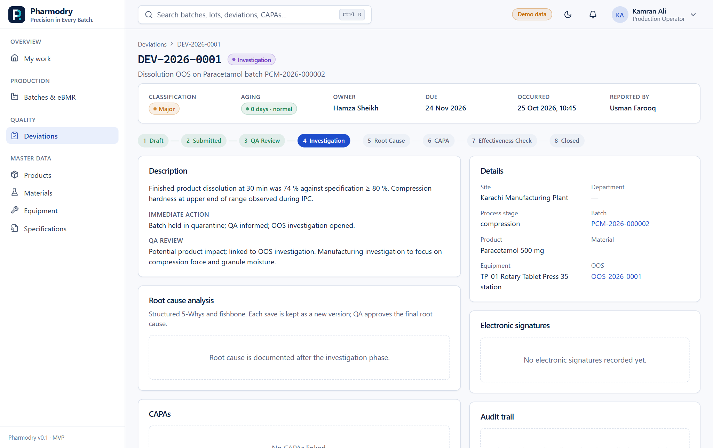

*Figure 15 — Deviation detail. Deviation record with workflow actions, RCA, CAPAs and evidence.*

#### Raise a deviation

1. Open Deviations → New (or Raise deviation on a batch, OOS or lot).
2. Under What happened enter Title, Description, Immediate action taken, Occurred at and optionally a Proposed severity.
3. Under Where & what is affected choose Site, Process stage and any Batch, Product, Material or Equipment.
4. Save as draft (then Submit to QA from the deviation page) or submit directly. Record what happened as soon as possible — QA classifies severity during review.

*Figure 16 — Raise a deviation. Deviation form: what happened, immediate action and affected records. (screen captured while signed in as QA Officer)*

*Figure 17 — Deviation submitted. Submitted deviation awaiting QA review. (screen captured while signed in as QA Officer)*

> **Not available to your role:** QA review and classification — requires deviation.approve; Investigate and record the root cause — requires deviation.investigate; CAPA decision and closure — requires deviation.approve; Use the AI investigation assistant — requires ai.assist.use.

### Master data: products, materials, suppliers, equipment and specifications

Regulated master data is versioned: every change requires a reason and creates a new immutable version (Version history). Products carry registration, shelf life, storage, GTIN (GS1, check digit verified), BOM and manufacturing template; materials carry type, retest period, safety stock and lead time; suppliers carry qualification status, approved materials and certifications; equipment carries calibration frequency and history; specifications hold versioned acceptance criteria.

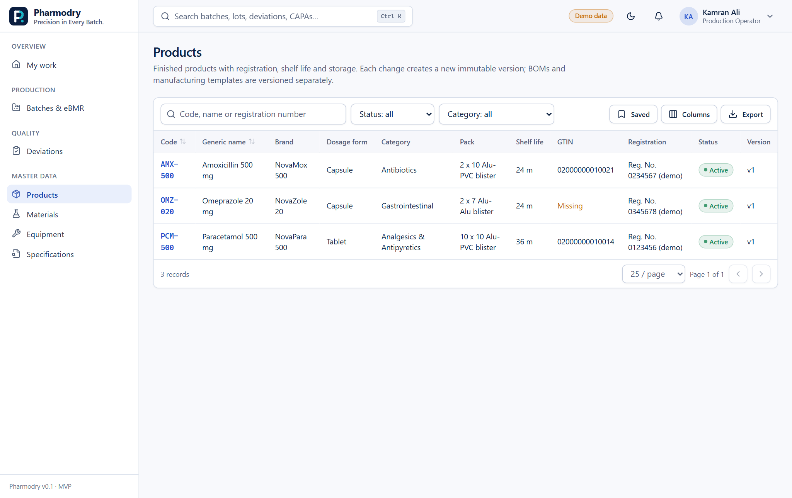

*Figure 18 — Products. Product master list with GTIN and registration.*

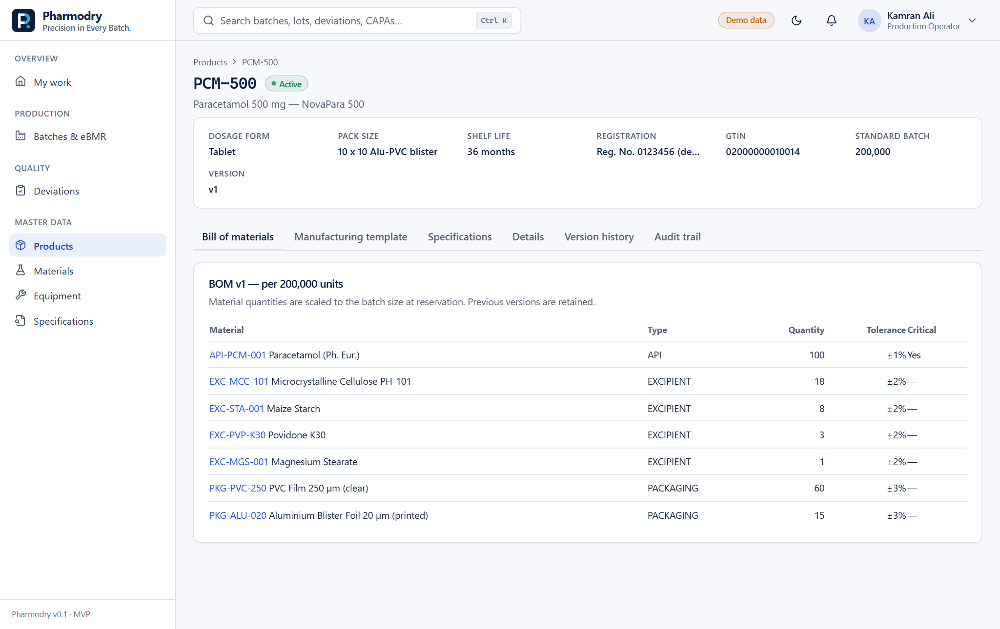

*Figure 19 — Product detail. Product detail: BOM, manufacturing template, specifications and versions.*

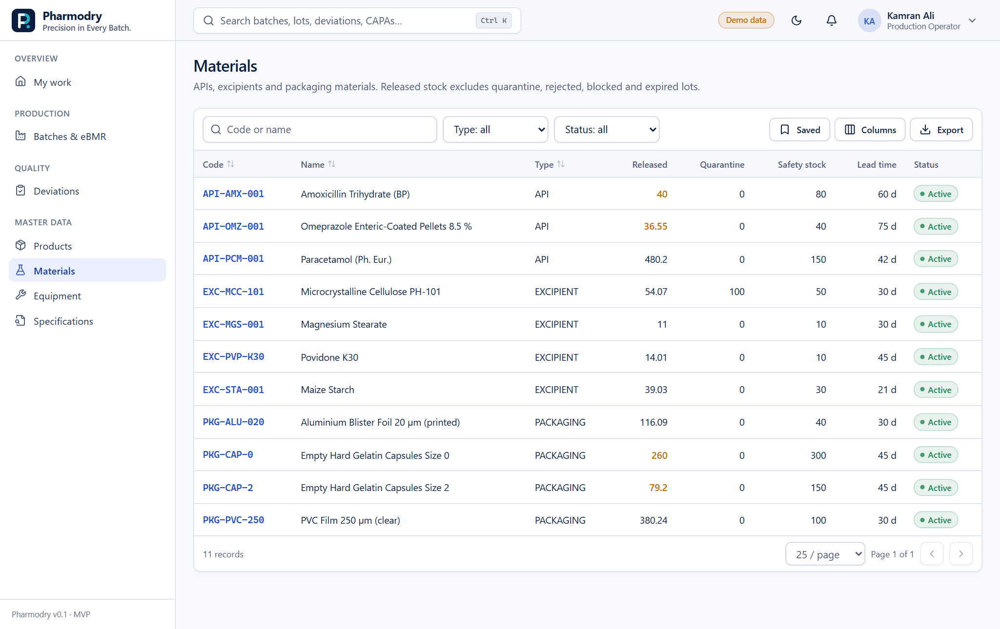

*Figure 20 — Materials. Material master with released and quarantined stock.*

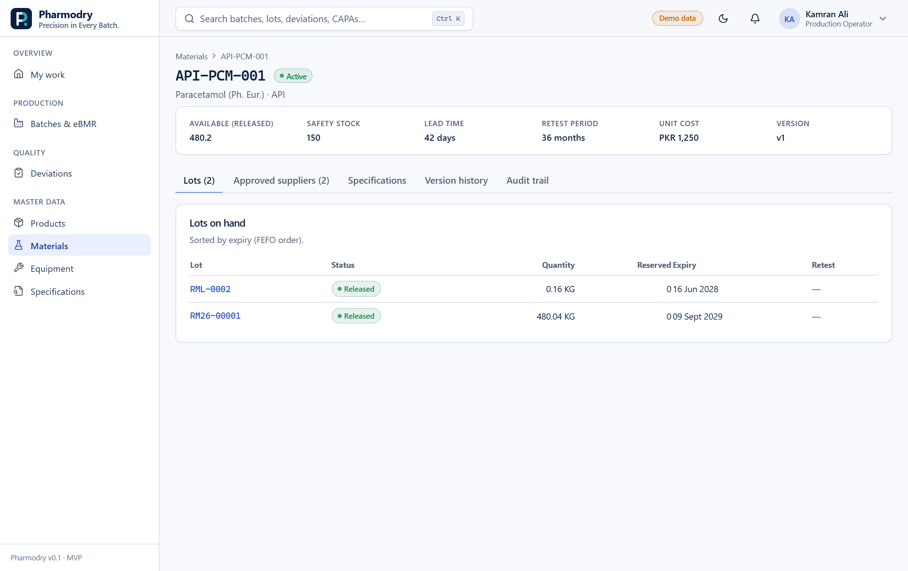

*Figure 21 — Material detail. Material detail: lots in FEFO order, approved suppliers, specifications.*

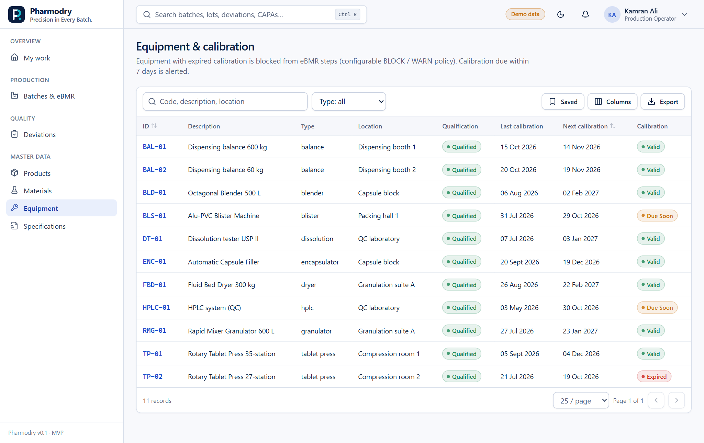

*Figure 22 — Equipment & calibration. Equipment list with calibration status.*

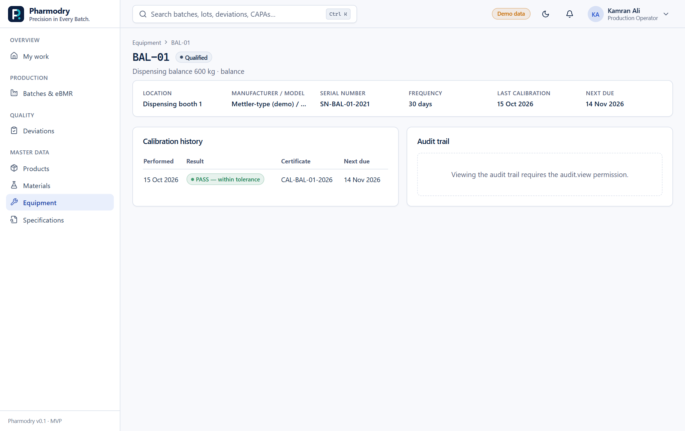

*Figure 23 — Equipment detail. Equipment detail with calibration history.*

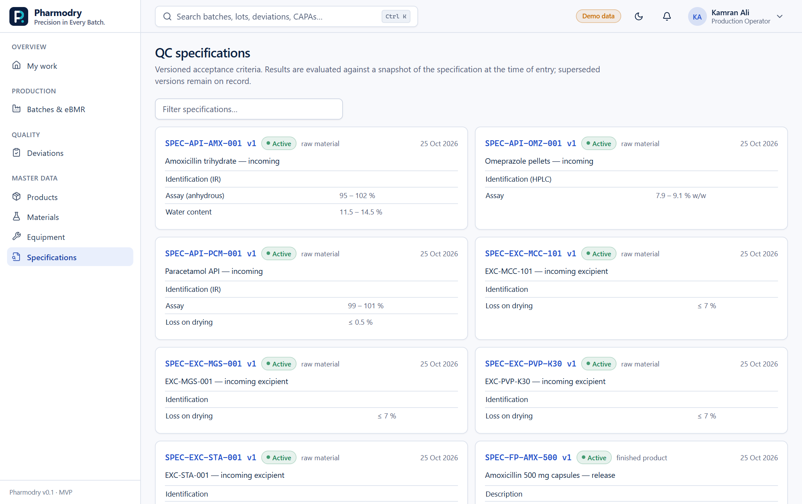

*Figure 24 — QC specifications. Versioned QC specifications.*

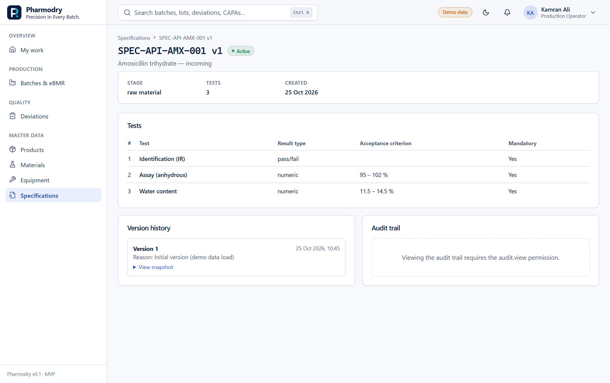

*Figure 25 — Specification detail. Specification tests and acceptance criteria.*

> **Not available to your role:** Create or edit a product — requires product.manage; Create or edit a material — requires material.manage; Create a supplier — requires supplier.manage; Change supplier qualification / approve a material — requires supplier.approve or supplier.manage; Record equipment calibration — requires equipment.manage.

## 7. Field-by-field explanations, required inputs and validation rules

General rules: required fields are marked; dates use the date picker; numbers must be positive unless stated; reasons must be at least 5 characters; unknown or malformed inputs are rejected by the server. Forms that you cannot submit are still shown for reference where you can view the module.

### Batches and electronic batch records (eBMR)

| Field | Required | Rules and meaning |
|---|---|---|
| Product | Yes | Active product with an active BOM and manufacturing template. |
| Production plan line | No | Plan must be APPROVED. |
| Batch size | Yes | Material quantities are scaled from the BOM. |
| Planned start | Yes | Date/time. |
| Equipment (step start) | If required | Qualified and calibrated equipment only. |
| Process parameters / IPC readings | Yes | Checked against limits; out-of-limit flagged. |
| Yield justification | If out of tolerance | At least 10 characters, or link a deviation. |

### Deviations

| Field | Required | Rules and meaning |
|---|---|---|
| Title | Yes | Short summary. |
| Description | Yes | At least 10 characters. |
| Immediate action taken | Recommended | Containment actions. |
| Occurred at | Yes | Date and time (local). |
| Proposed severity | No | QA decides the classification. |
| Site / Process stage | Yes | Where it happened. |
| Batch / Product / Material / Equipment | No | Links affected records. |

## 8. Buttons and their functions

| Module | Button | What it does | Available to you |
|---|---|---|---|
| Batches and electronic batch records (eBMR) | Reserve materials | FEFO reservation of released lots. | No (needs batch.reserve) |
| Batches and electronic batch records (eBMR) | Release reservation | Returns reservations (reason required). | No (needs batch.reserve) |
| Batches and electronic batch records (eBMR) | Issue materials | Dispenses reserved lots to production. | No (needs inventory.issue) |
| Batches and electronic batch records (eBMR) | Start batch | Moves READY → IN PROGRESS. | No (needs batch.start) |
| Batches and electronic batch records (eBMR) | Start / Record & sign | Executes and signs eBMR steps. | Yes |
| Batches and electronic batch records (eBMR) | Verify | Second-person verification with signature. | No (needs batch.verify) |
| Batches and electronic batch records (eBMR) | Correct | Corrects a recorded value with reason. | Yes |
| Batches and electronic batch records (eBMR) | Complete manufacturing | Calculates yield, books FG into quarantine. | No (needs batch.complete) |
| Batches and electronic batch records (eBMR) | QA release / Reject | Final disposition with electronic signature. | No (needs batch.approve) |
| Batches and electronic batch records (eBMR) | Close batch | Closes a released or rejected batch. | No (needs batch.approve) |
| Batches and electronic batch records (eBMR) | Cancel | Cancels a batch before it starts (reason required). | No (needs batch.create) |
| Batches and electronic batch records (eBMR) | Trace | Opens traceability & mock recall for the batch (needs inventory.view too). | No (needs inventory.view) |
| Batches and electronic batch records (eBMR) | Batch record | Printable executed batch record. | Yes |

Buttons you cannot use are hidden or disabled in the application; the server refuses the action even if attempted another way.

## 9. Workflow, approvals and electronic signatures

The table shows the main GMP workflow and where your role takes part. Segregation of duties is enforced by the server: the person who performs a step cannot review, verify or approve it.

| Workflow step | Permission | Your role |
|---|---|---|
| Raise purchase order | procurement.po.create | — |
| Approve purchase order (different person) | procurement.po.approve | — |
| Receive goods (GRN) → lots in QUARANTINE, QC sample requested | inventory.receive | — |
| Collect sample and enter results | qc.result.enter | — |
| Review results (different person) | qc.result.review | — |
| Approve QC sample (e-signature) | qc.result.approve | — |
| QA disposition of material lot (e-signature) | inventory.release | — |
| Create / approve production plan | production.plan.manage | — |
| Create batch | batch.create | — |
| Reserve materials (FEFO, released lots only) | batch.reserve | — |
| Issue materials to production | inventory.issue | — |
| Start batch | batch.start | — |
| Execute and sign eBMR steps | batch.execute | You perform this |
| Verify eBMR steps (different person, e-signature) | batch.verify | — |
| Complete manufacturing (yield, FG to QUARANTINE) | batch.complete | — |
| Finished-product QC (enter / review / approve) | qc.result.enter | — |
| QA batch release or rejection (e-signature) | batch.approve | — |
| Raise deviation | deviation.create | You perform this |
| Investigate deviation / OOS | deviation.investigate | — |
| Classify, approve and close deviations | deviation.approve | — |
| Conclude OOS (e-signature) | oos.approve | — |
| Create and manage CAPA | capa.create | — |
| Close CAPA (e-signature) | capa.close | — |

### Electronic signatures

- Critical actions (approvals, releases, rejections, verifications, closures) open an Electronic signature dialog.
- Read the meaning of the signature shown in the dialog, enter a reason where requested and re-enter your password.
- “Your signature is legally binding within your company’s validated procedures.” A wrong password changes nothing and the failed attempt is recorded.
- The signature (your name, meaning, reason, time) is stored with the record and in the audit trail.

## 10. Status meanings

| Status | Meaning |
|---|---|
| PLANNED | Batch created; materials not yet reserved. |
| MATERIAL RESERVED | Released lots reserved (FEFO). |
| READY | Materials issued; batch can start. |
| IN PROGRESS | Manufacturing in progress (batch, step or CAPA). |
| AWAITING QC | Manufacturing complete; finished-product QC pending. |
| AWAITING QA | QC complete; QA decision pending. |
| RELEASED | Approved by QA (lot) or released for sale (batch). |
| REJECTED | Rejected by QA; may not be used or sold. |
| CLOSED | Completed and closed. |
| CANCELLED | Cancelled with a reason; kept on record. |
| PENDING | eBMR step not started. |
| COMPLETED | eBMR step completed and signed by the operator (or CAPA action completed). |
| VERIFIED | eBMR step verified by a second person. |
| DRAFT | Draft, not yet submitted/approved. |
| SUBMITTED | Submitted for review. |
| QA REVIEW | Deviation under QA review. |
| INVESTIGATION | Deviation under investigation. |
| ROOT CAUSE | Root cause being documented. |
| CAPA | CAPA decision stage. |
| EFFECTIVENESS CHECK | Awaiting effectiveness check. |
| MINOR | Minor deviation. |
| MAJOR | Major deviation. |
| CRITICAL | Critical deviation / priority. |
| ACTIVE | Active master data. |
| INACTIVE | Inactive; cannot be used for new transactions. |
| PENDING QUALIFICATION | Supplier not yet qualified. |
| APPROVED | Approved (sample, supplier, PO or plan). |
| CONDITIONALLY APPROVED | Supplier approved with conditions. |
| SUSPENDED | Supplier suspended. |
| BLACKLISTED | Supplier barred. |
| QUALIFIED | Equipment qualified. |
| NOT QUALIFIED | Equipment not qualified. |
| RETIRED | Equipment retired. |

## 11. Search, filters, sorting and pagination

- Search table: type to filter rows in the current list.
- Quick views and filters above the table (for example Open / Overdue / All, status, type, warehouse) narrow the list; Saved filters stores your combination.
- Choose columns shows or hides columns; select a column header to sort.
- Rows per page and Previous / Next page control pagination (up to 200 rows per page).
- Export CSV downloads the current list (requires the export permission; exports are audited).

## 12. Reports and exports

| Report | Where | Export allowed |
|---|---|---|
| Batch summary (CSV) | Reports → Batch summary | View only — export needs report.export |
| Batch manufacturing record (print / PDF) | Batch page → Batch record | Yes (print) |
| Deviation register (CSV) | Deviations → Export CSV | View only — export needs report.export |
| Mock-recall reconciliation (CSV) | Traceability & recall → Export recall reconciliation | View only — export needs report.export |

Every export is recorded in the audit trail. CSV files are UTF-8 and protected against spreadsheet formula injection.

## 13. Notifications and alerts

- The bell shows unread notifications; Notifications → Inbox lists them and Mark all read clears the counter.
- Alerts come from workflows (for example QC sample requested, OOS reported, batch awaiting QA, assignment) and scheduled compliance scans (expiry, low stock, overdue CAPAs/deviations, calibration due, QA backlog).
- My preferences lets you choose which notifications you receive. In-app delivery is on by default; e-mail delivery requires SMTP configuration by an administrator and is not active in this release.

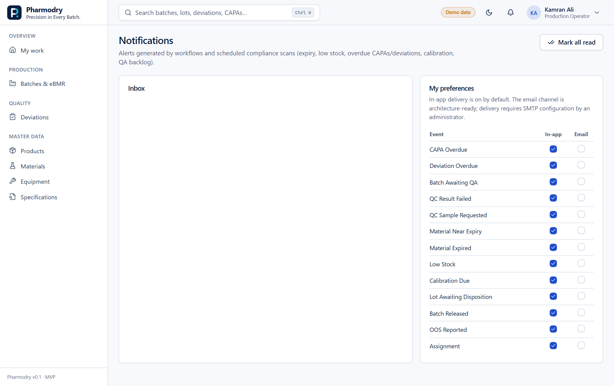

*Figure 26 — Notifications. Notification inbox and preferences.*

## 14. Error messages and troubleshooting

| Message or symptom | Cause | What to do |
|---|---|---|
| 403 / “Missing permission …” | Your role does not include the permission, or it is limited to another site. | Ask your Company Admin to review your role assignment. |
| “Action blocked by business rules” with a list of reasons | A GMP rule prevents the action (for example QC not approved). | Open each reason link and resolve it; the rule cannot be overridden. |
| “Account locked after repeated failed attempts” | Five wrong passwords. | Wait 15 minutes or ask an administrator to unlock. |
| Session expired / returned to sign-in | Inactive session or revoked session. | Sign in again. |
| Electronic signature failed | Wrong password. | Re-enter the password; nothing was saved. |
| “… was modified concurrently; reload and retry” | Another user changed the record. | Reload the page and repeat your action. |
| Unknown field / validation messages on forms | Missing or invalid input. | Correct the highlighted fields. |
| Insufficient released material to reserve this batch | Shortage of released stock. | Escalate to planning/QA; do not use quarantined stock. |
| Calibration expired | Selected equipment is past its calibration due date. | Use other equipment or contact Engineering; under BLOCK policy the step cannot start. |
| Segregation of duties: the operator who performed a step cannot verify it | Same person. | Ask another supervisor. |
| QA release is blocked | Release blockers exist. | Resolve each listed reason first. |
| Batch … was modified concurrently; reload and retry | Someone else changed the batch. | Reload the page and repeat. |
| Action blocked by business rules | Required information missing for the next step. | Read the listed reasons and complete them. |
| GTIN … is not a valid GS1 GTIN (length or check digit) | Wrong length or check digit. | Enter the 8, 12, 13 or 14-digit GTIN exactly as allocated by GS1. |

## 15. Common mistakes and how to prevent them

- Entering supplier batch, expiry or quantities that differ from the container label or CoA — always copy exactly.
- Trying to use quarantined or under-test material — only RELEASED lots can be reserved; wait for QA release.
- Signing for someone else or sharing passwords — each signature must be your own.
- Delaying deviation reporting — raise the deviation as soon as the event is known; QA classifies it.
- Replacing results to “fix” an OOS — OOS results cannot be replaced during an investigation; follow the OOS procedure.
- Closing CAPAs without objective evidence — the effectiveness check must be documented.

## 16. Security and access limitations

Permissions granted to your role (as enforced by the server):

| Permission | Meaning |
|---|---|
| batch.execute | Execute eBMR steps as operator |
| batch.view | View batches and eBMR |
| deviation.create | Raise deviations |
| deviation.view | View deviations |
| masterdata.view | View master data |

Not granted (54 permissions): admin.tenant.manage, admin.site.manage, admin.user.manage, admin.role.manage, product.manage, material.manage, supplier.view, supplier.manage, supplier.approve, equipment.manage, spec.manage, procurement.po.view, procurement.po.create, procurement.po.approve, inventory.view, inventory.receive, inventory.transfer, inventory.adjust, inventory.issue, inventory.release, production.plan.view, production.plan.manage, production.plan.approve, batch.create, batch.reserve, batch.start, batch.verify, batch.complete, batch.approve, qc.view, qc.sample.create, qc.sample.collect, qc.result.enter, qc.result.review, qc.result.approve, oos.view, oos.create, oos.investigate, oos.approve, deviation.investigate, deviation.approve, capa.view, capa.create, capa.manage, capa.verify, capa.close, audit.view, audit.export, analytics.view, commandcenter.view, report.export, ai.copilot.use, ai.assist.use, ai.admin.

### Procedures you cannot perform

- Batches and electronic batch records (eBMR): Create a batch — requires batch.create
- Batches and electronic batch records (eBMR): Reserve materials (FEFO) — requires batch.reserve
- Batches and electronic batch records (eBMR): Issue materials to production — requires inventory.issue
- Batches and electronic batch records (eBMR): Start the batch — requires batch.start
- Batches and electronic batch records (eBMR): Verify eBMR steps — requires batch.verify
- Batches and electronic batch records (eBMR): Complete manufacturing — requires batch.complete
- Batches and electronic batch records (eBMR): QA release or rejection of a batch — requires batch.approve
- Deviations: QA review and classification — requires deviation.approve
- Deviations: Investigate and record the root cause — requires deviation.investigate
- Deviations: CAPA decision and closure — requires deviation.approve
- Deviations: Use the AI investigation assistant — requires ai.assist.use
- Master data: products, materials, suppliers, equipment and specifications: Create or edit a product — requires product.manage
- Master data: products, materials, suppliers, equipment and specifications: Create or edit a material — requires material.manage
- Master data: products, materials, suppliers, equipment and specifications: Create a supplier — requires supplier.manage
- Master data: products, materials, suppliers, equipment and specifications: Change supplier qualification / approve a material — requires supplier.approve or supplier.manage
- Master data: products, materials, suppliers, equipment and specifications: Record equipment calibration — requires equipment.manage

- Your role may additionally be limited to specific sites; records of other sites are then hidden or read-only.
- Never share your password: it is also your electronic-signature credential.
- Sign out or lock your screen when leaving the workstation.

## 17. Practical end-to-end example

Based on the fictional NovaCure demonstration data:

1. Open the in-progress batch → Manufacturing (eBMR). The next step (e.g. Granulation) shows Start.
2. Select Start, choose the granulator, confirm. Perform the operation.
3. Select Record & sign, enter mixing time and impeller speed, re-enter your password and sign. The step shows COMPLETED and waits for supervisor verification.

## 18. Frequently asked questions

**Why is the release button disabled?** The server has found release blockers; they are listed on the page with links.

**Can I delete a record I created by mistake?** No. Regulated records are cancelled or corrected with a reason, never deleted.

**Why can I see a module but not its action buttons?** View and action permissions are separate; your role may be read-only for that module.

**Does the AI make decisions?** No. The Copilot and assistants only explain computed facts or draft suggestions; people decide and sign.

**What time zone are dates shown in?** Times are stored in UTC and displayed in Pakistan time (Asia/Karachi) in this release.

**Is this the official batch record?** The executed eBMR in Pharmodry is the electronic record; the printable view is a copy for review. Your SOPs define the official record.

## 19. Glossary

| Term | Meaning |
|---|---|
| ALCOA+ | Data-integrity principles: Attributable, Legible, Contemporaneous, Original, Accurate, plus Complete, Consistent, Enduring, Available. |
| API | Active Pharmaceutical Ingredient. |
| BOM | Bill of materials — quantities of materials per standard batch. |
| CAPA | Corrective and Preventive Action. |
| CoA | Certificate of Analysis from the supplier. |
| Deviation | Departure from an approved instruction or standard. |
| DRAP | Drug Regulatory Authority of Pakistan. |
| eBMR | Electronic Batch Manufacturing Record. |
| E-signature | Electronic signature: password re-entry linked to a record, meaning and reason. |
| FEFO | First Expiry, First Out — earliest-expiring released lots are used first. |
| FG | Finished goods. |
| GMP | Good Manufacturing Practice. |
| GRN | Goods Receipt Note. |
| GS1 / GTIN | Global standards body / Global Trade Item Number used in the 2D DataMatrix. |
| IPC | In-process control. |
| Lot | A quantity of one material or product with one internal lot number at one location. |
| OOS | Out of specification — a result outside its acceptance criteria. |
| OOT | Out of trend. |
| PQR | Product Quality Review (annual review of a product’s quality data). |
| Quarantine | Status of material that may not be used until released by QA. |
| Retest date | Date after which a material must be re-tested before use. |
| SoD | Segregation of duties — the same person may not perform and approve/verify. |
| SOP | Standard Operating Procedure. |
| Yield | Actual output as a percentage of theoretical output. |

## 20. Escalation

Escalate through the roles configured in your company. This release has no built-in external support desk and no vendor contact details; use your company’s documented support and incident procedures.

- Any departure from instructions, damaged material, equipment fault or out-of-limit reading: stop, inform your supervisor and raise a deviation.

- Access problems (locked account, missing permission): Company Admin.
- Any suspected data-integrity problem (for example “Integrity failure” on audit verification): QA Manager immediately.
